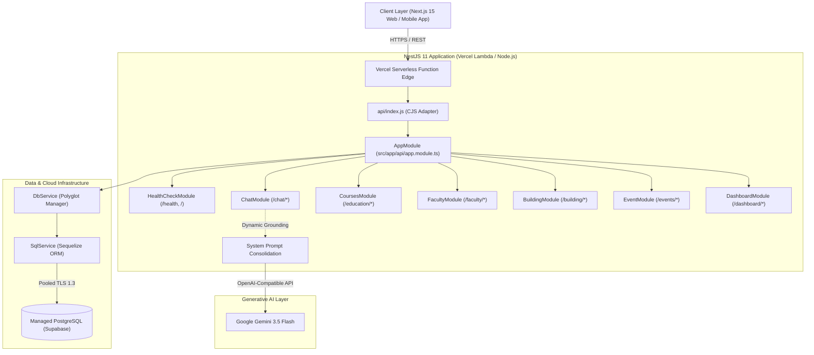
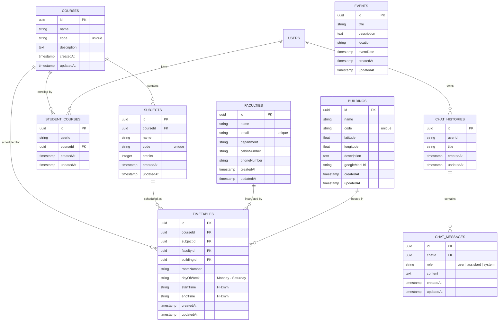

# Campus GPT — Backend API & AI Orchestration Engine

[](https://nodejs.org/)
[](https://nestjs.com/)
[](https://www.typescriptlang.org/)
[](https://supabase.com/)
[](https://deepmind.google/technologies/gemini/)
[](https://vercel.com/)

Campus GPT Backend is an enterprise-grade academic management system and AI concierge engine. Built on **NestJS 11**, **TypeScript**, and **PostgreSQL (via Sequelize)**, it provides deterministic context grounding for AI-assisted student life, timetable conflict resolution, campus building geolocation, and academic analytics.

---

## 1. System Architecture Overview

The backend uses a modular, decoupled architecture adhering to Domain-Driven Design (DDD) principles. It is optimized for serverless execution on **Vercel Functions** while preserving full compatibility with containerized Docker / Node.js runtimes.



---

## 2. Entity-Relationship Diagram (Database Schema)

The PostgreSQL relational schema enforces strict foreign-key integrity across university entities:



---

## 3. Exhaustive API Reference Catalog

All successful responses follow the unified envelope:
```json
{
  "data": { ... },
  "meta": {
    "success": true,
    "message": "SUCCESS",
    "statusCode": 200
  }
}
```

### 3.1 System Probes & Documentation

| Method | Endpoint | Auth | Description | Response Data |
| :--- | :--- | :--- | :--- | :--- |
| `GET` | `/` or `/api` | None | Base API availability health check | `{ "status": "ok", "message": "Campus GPT Backend API is running", "timestamp": "..." }` |
| `GET` | `/health` | None | Terminus PostgreSQL database connectivity probe | `{ "status": "ok", "info": { "Postgres": { "status": "up" } } }` |
| `GET` | `/docs` | None | Interactive Swagger UI API playground | Full Swagger HTML & OpenAPI schema |

### 3.2 AI Chatbot Service (`/chat`)

| Method | Endpoint | Auth | Description | Payload Sample |
| :--- | :--- | :--- | :--- | :--- |
| `POST` | `/chat/new-chat` | Bearer | Initialize a new conversational session | `{ "title": "MCA Semester 1 Inquiries" }` |
| `POST` | `/chat/message` | Bearer | Send user prompt, trigger context grounding & Gemini reply | `{ "chatId": "<uuid>", "content": "When is my next Database class?" }` |
| `GET` | `/chat/rooms` | Bearer | List all conversation rooms belonging to current student | None |
| `GET` | `/chat/messages?chatId=<id>` | Bearer | Fetch message history for a specific room | None |
| `DELETE` | `/chat/rooms?chatId=<id>` | Bearer | Delete conversation room and message history | None |

### 3.3 Academic Courses & Timetables (`/education`)

| Method | Endpoint | Auth | Description | Payload Sample |
| :--- | :--- | :--- | :--- | :--- |
| `GET` | `/education/courses` | Optional | Retrieve list of all university degree programs | None |
| `POST` | `/education/courses` | Admin | Register new degree program (e.g., MCA, BCA) | `{ "name": "Master of Computer Applications", "code": "MCA" }` |
| `GET` | `/education/course?id=<id>` | Optional | Get detailed course view by ID | None |
| `POST` | `/education/course/join` | Bearer | Enroll the authenticated student in a course | `{ "courseId": "<uuid>" }` |
| `GET` | `/education/course/joined` | Bearer | Get the student's currently active enrolled course | None |
| `POST` | `/education/subjects` | Admin | Create subject tied to a course | `{ "name": "Operating Systems", "code": "CAP502", "courseId": "..." }` |
| `GET` | `/education/subjects?courseId=<id>` | Optional | List all subjects belonging to a course | None |
| `POST` | `/education/complete-timetable` | Admin | Batch deploy entire timetable schedule for a course | `{ "courseId": "...", "slots": [ { "dayOfWeek": "Monday", ... } ] }` |
| `GET` | `/education/course-timetable?courseId=<id>`| Optional | Fetch weekly schedule resolved with faculty and rooms | None |

### 3.4 Faculty Management (`/faculty`)

| Method | Endpoint | Auth | Description | Payload Sample |
| :--- | :--- | :--- | :--- | :--- |
| `GET` | `/faculty` | None | List all university professors and staff | None |
| `POST` | `/faculty` | Admin | Register new faculty profile with cabin & contact | `{ "name": "Dr. Sharma", "email": "sharma@lpu.co.in", "cabinNumber": "34-201" }` |
| `GET` | `/faculty/by-id?id=<id>` | None | Retrieve faculty member profile | None |
| `PATCH`| `/faculty?id=<id>` | Admin | Update contact information or office location | `{ "cabinNumber": "34-205" }` |
| `DELETE`| `/faculty?id=<id>` | Admin | Remove faculty member | None |

### 3.5 Campus Buildings & Geolocation (`/building`)

| Method | Endpoint | Auth | Description | Payload Sample |
| :--- | :--- | :--- | :--- | :--- |
| `GET` | `/building` | None | List all campus blocks and navigation links | None |
| `POST` | `/building` | Admin | Add university building with coordinates | `{ "name": "Block 34", "code": "B34", "latitude": 31.25, "longitude": 75.70 }` |
| `DELETE`| `/building?id=<id>` | Admin | Delete building record | None |

### 3.6 Campus Events (`/events`)

| Method | Endpoint | Auth | Description | Payload Sample |
| :--- | :--- | :--- | :--- | :--- |
| `GET` | `/events` | None | Fetch upcoming campus activities & seminars | None |
| `POST` | `/events` | Admin | Publish a new university event | `{ "title": "Hackathon 2026", "eventDate": "2026-11-15T10:00:00Z" }` |
| `DELETE`| `/events?id=<id>` | Admin | Cancel/remove campus event | None |

### 3.7 Institutional Analytics (`/dashboard`)

| Method | Endpoint | Auth | Description | Metrics Returned |
| :--- | :--- | :--- | :--- | :--- |
| `GET` | `/dashboard/admin` | Admin | Executive summary of university operational state | `{ totalStudents, totalFaculty, totalCourses, totalBuildings, recentEnrollments, upcomingEvents }` |
| `GET` | `/dashboard/student`| Bearer | Personal student daily agenda | `{ enrolledCourse, todayTimetable, upcomingEvents }` |

---

## 4. Environment Variables Specification

Create a `.env.local` file in the `backend/` directory for local development, or add these variables to your Vercel Project Settings:

```bash
# Server Port (used in local execution, ignored on Vercel)
PORT=4000

# PostgreSQL Connection String (Supabase / Managed PostgreSQL)
# Must include connection pooler URL or session URL with SSL support
POSTGRES_CONNECTION_STRING=postgresql://postgres.<ref>:<password>@aws-0-ap-southeast-1.pooler.supabase.com:5432/postgres

# Google Gemini API Configuration (via OpenAI-compatible endpoint)
GEMINI_API_KEY=your_gemini_api_key_here
GEMINI_MODEL=gemini-3.5-flash
GEMINI_URL=https://generativelanguage.googleapis.com/v1beta/openai/chat/completions

# Internal Security Secret (used to authorize admin / backend sync operations)
X_SECRET=your_super_secret_internal_key

# Node Environment
NODE_ENV=production
```

---

## 5. Local Setup & Execution Guide

### Prerequisites
- Node.js 20.x or 22.x LTS
- Yarn 1.22+ or npm 10+
- Access to a PostgreSQL 15+ database instance (e.g. Supabase)

### Installation
```bash
# Clone and enter directory
cd backend

# Install dependencies
yarn install
```

### Running Locally
```bash
# Run in development mode with live-reload
yarn dev

# Run in debug mode
yarn start:debug

# Compile production build
yarn build

# Run pre-compiled production build locally
yarn start:prod
```

---

## 6. Serverless Vercel Deployment

The repository is pre-configured with `backend/vercel.json` and `backend/api/index.js` for instant deployment:

```bash
# Build the project to verify TypeScript compilation
yarn build

# Deploy via Vercel CLI
vercel --prod
```

### Key Vercel Configuration Details
1. **Build Step**: Vercel runs `yarn build`, which compiles `src/` to `dist/` with full TypeScript decorator metadata preserved.
2. **Serverless Entry**: `api/index.js` acts as the Lambda entrypoint, requiring pre-compiled `dist/` modules and caching the NestJS Express instance in memory across requests.
3. **Rewrite Rule**: `vercel.json` rewrites all traffic `/(.*)` (except exact `/api`) to `/api` without triggering infinite recursion loops.
4. **Interactive Documentation**: Swagger UI is accessible directly at `https://<your-vercel-domain>/docs`.

---

## 7. Directory Layout

```text
backend/
├── api/
│   └── index.js                         # Vercel Serverless Function entry point
├── src/
│   ├── app/
│   │   └── api/
│   │       └── app.module.ts            # Root NestJS application module
│   ├── core/
│   │   ├── constants/                   # HTTP and user role constants
│   │   ├── dtos/                        # Base request & response envelopes
│   │   ├── filters/                     # HttpExceptionFilter for clean error outputs
│   │   ├── guards/                      # UserGuard & auth verification
│   │   ├── health-check/                # Terminus SQL probes & root status handler
│   │   ├── interceptors/                # ReqResInterceptor & logging interceptor
│   │   └── services/
│   │       ├── db-service/              # Sequelize connection manager & providers
│   │       │   ├── models.ts            # SQL model registry & association loader
│   │       │   └── providers/           # SqlService (with SSL) & MongoService
│   │       └── logger/                  # Structured JSON LoggerService
│   ├── modules/
│   │   ├── building/                    # Campus building coordinates & map links
│   │   ├── chatbot/                     # Gemini AI integration & context pruning
│   │   ├── courses/                     # Programs, subjects & timetable scheduling
│   │   ├── dashboard/                   # Institutional KPI aggregation
│   │   ├── events/                      # University activities calendar
│   │   └── faculty/                     # Professor directory & office locations
│   └── main.ts                          # Standard Node.js entry point (local dev / Docker)
├── decission.md                         # Architecture Decision Records (ADRs)
├── flowchart.md                         # Detailed execution flows & Mermaid diagrams
├── package.json                         # Dependencies & scripts
├── tsconfig.json                        # TypeScript configuration
├── tsconfig.build.json                  # NestJS build exclusions
└── vercel.json                          # Vercel deployment & routing config
```

---

## 8. Development & Project Contributors

Campus GPT is developed and maintained by:
- **Ajay**
- **Muskan**
- **Madhav**
- **Aayush**
- **Prince**
