# Campus GPT Backend — Code Execution & Request Flowcharts

This document provides exhaustive, production-grade flowcharts, sequence diagrams, and lifecycle architectures for the **Campus GPT Backend**. It traces code execution from the edge (Vercel Serverless Function) through all NestJS layers (Interceptors, Guards, Pipes, Controllers, Services, Models, and External AI APIs) with zero omitted details.

---

## 1. High-Level Request Pipeline Architecture

Every incoming HTTP request to the Campus GPT Backend traverses a deterministic, multi-stage processing pipeline before reaching business logic and returning a standardized response envelope.

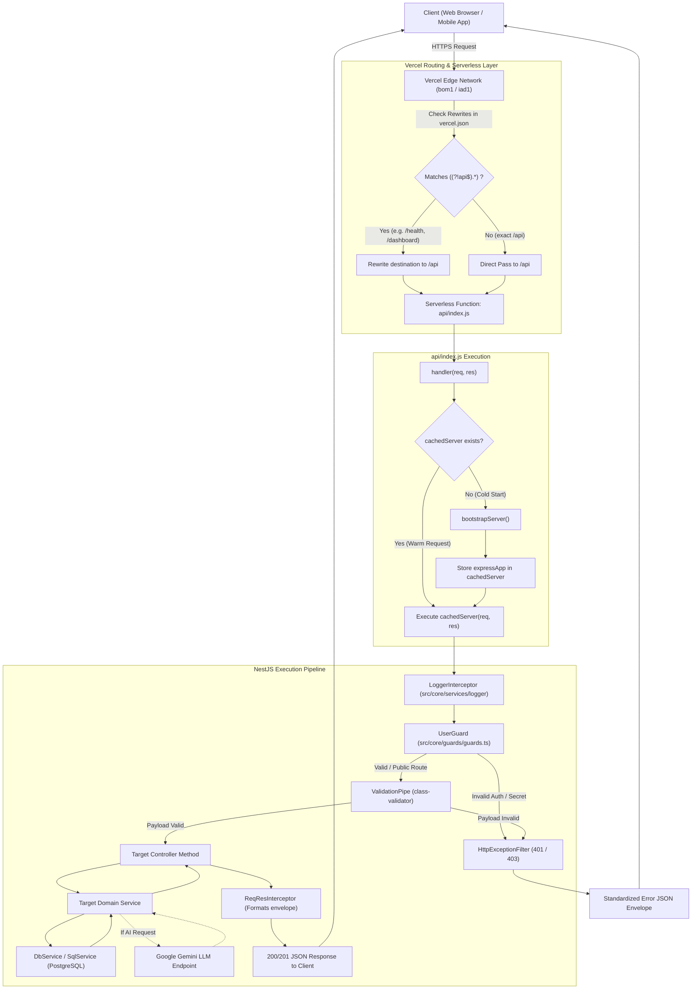

---

## 2. Serverless Cold-Start & Bootstrap Lifecycle

When a Lambda container is instantiated by Vercel, the NestJS application is lazily created and initialized once. Subsequent requests reuse the warm in-memory container.

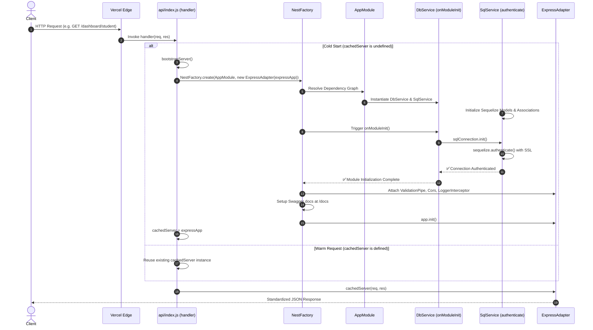

---

## 3. Authentication & Security Guard Flow (`UserGuard`)

Protected endpoints require verification of student or admin identity via Bearer tokens or secret headers.

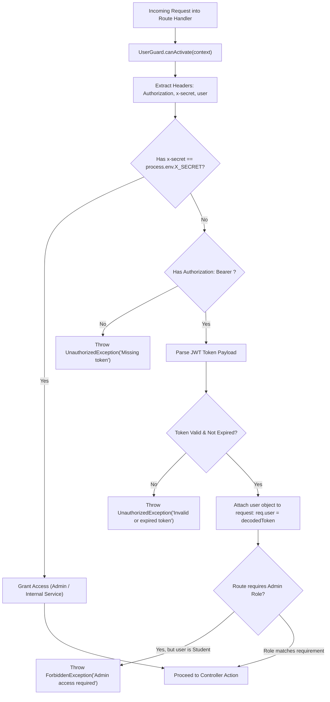

---

## 4. Chatbot Conversation & Two-Tier Semantic RAG Execution Flow

The AI Chatbot provides student-specific, hallucination-free answers via a Two-Tier architecture combining deterministic relational context with semantic vector retrieval across pre-indexed Entity Cards.

### 4.1 Two-Tier RAG Message Handling Sequence

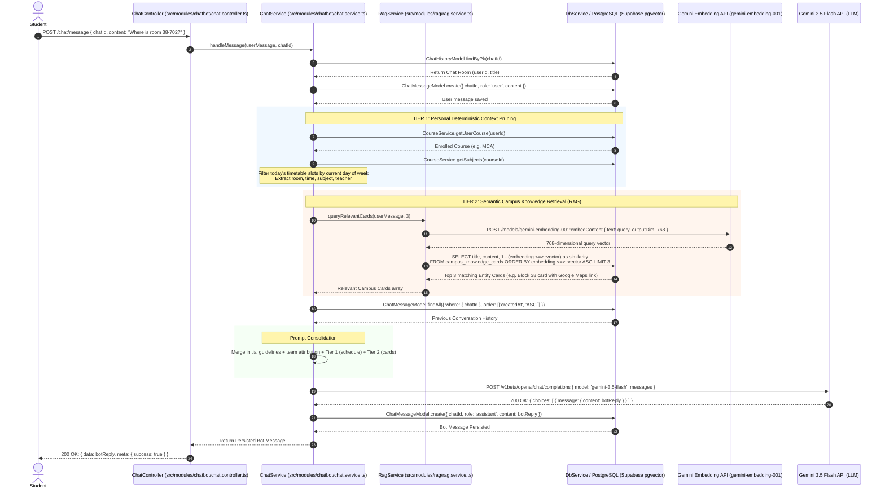

### 4.2 Entity Cards Sync & Vector Indexing Pipeline

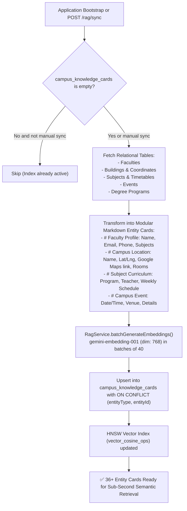

---

## 5. Academic Course & Timetable Management Flow

### 5.1 Student Course Enrollment & Timetable Resolution

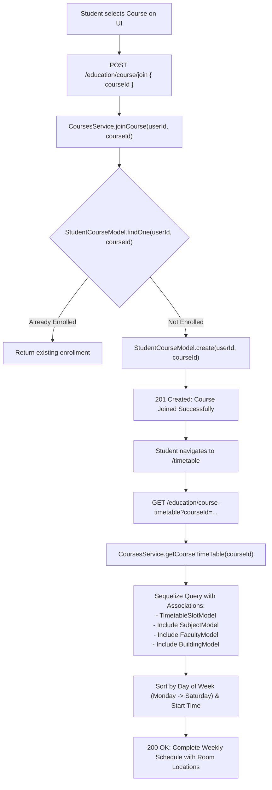

### 5.2 Admin Course & Complete Timetable Creation

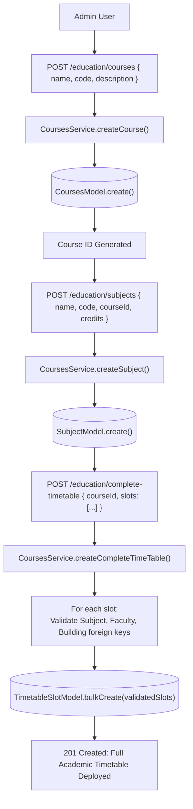

---

## 6. Campus Building & Navigation Geolocation Flow

Campus buildings are mapped with geographic coordinates and Google Maps directions to empower the AI assistant and interactive directory to navigate students across campus.

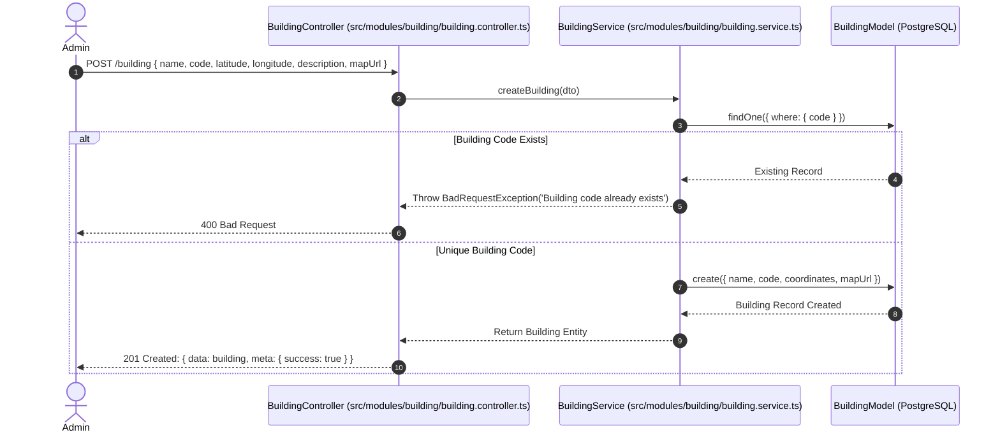

---

## 7. Administrative Dashboard Aggregation Flow

The admin dashboard aggregates institutional data in real time to present enrollment KPIs, faculty counts, and academic distributions.

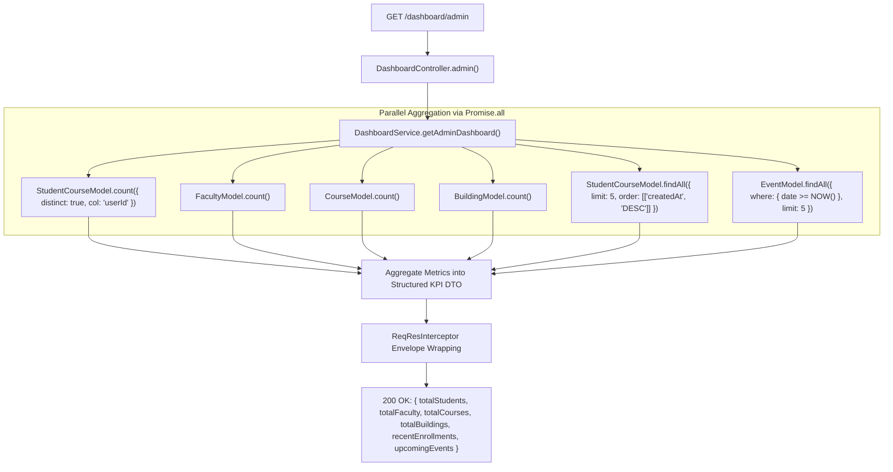

---

## 8. Database Connection & Remote SSL Handshake

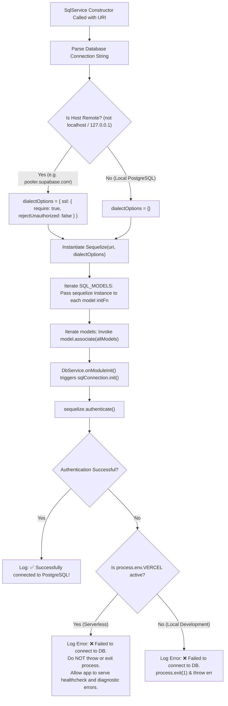

---

## 9. Global Error Shielding & Exception Filter Flow

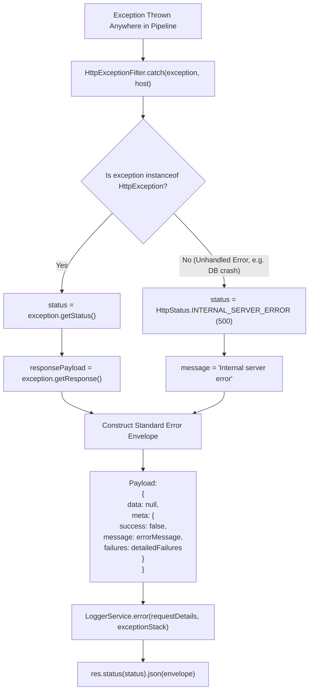
